### Hey, I'm André 👋

I build software with AI agents in Lima, Peru 🇵🇪. I run [Cofoundy](https://cofoundy.dev), a small software studio, with [@Melissa1221](https://github.com/Melissa1221), [@lepaccio](https://github.com/lepaccio) and [@JuanSilva2000](https://github.com/JuanSilva2000). Agents write and review our code; we decide what's worth building and check that it works in production. That explains my contribution graph.

<picture>
  <source media="(prefers-color-scheme: dark)" srcset="assets/week-dark.svg">
  
</picture>

**Lately**

- [**basalt-plugin**](https://github.com/cofoundy/basalt-plugin) — publish docs straight from Claude Code, Codex or Cursor · 1d&nbsp;ago
- [**dagyard**](https://github.com/cofoundy/dagyard) — a live DAG of your coding agents' plan; the tasks that need you turn amber · 5d&nbsp;ago
- [**brand-skills**](https://github.com/cofoundy/brand-skills) — turn an idea into a brand (name, identity, voice) without leaving your agent · 12d&nbsp;ago
- [**mailglow**](https://github.com/cofoundy/mailglow) — vibe-code HTML emails that survive Gmail, Outlook and Apple Mail · 22d&nbsp;ago
- [**aurora**](https://github.com/A-PachecoT/aurora) — a CBT thought record that never leaves your device · 52d&nbsp;ago

Yes, that's me at #1 on [committers.top for Peru](https://committers.top/peru_private). Mostly the agents' fault. If you follow anyone here, follow my teammates too: the agents answer to them.

[andre@cofoundy.dev](mailto:andre@cofoundy.dev) · [LinkedIn](https://www.linkedin.com/in/andrepachecot/) · [cofoundy.dev](https://cofoundy.dev)

<!-- generado por build.py · 2026-10-18 -->
